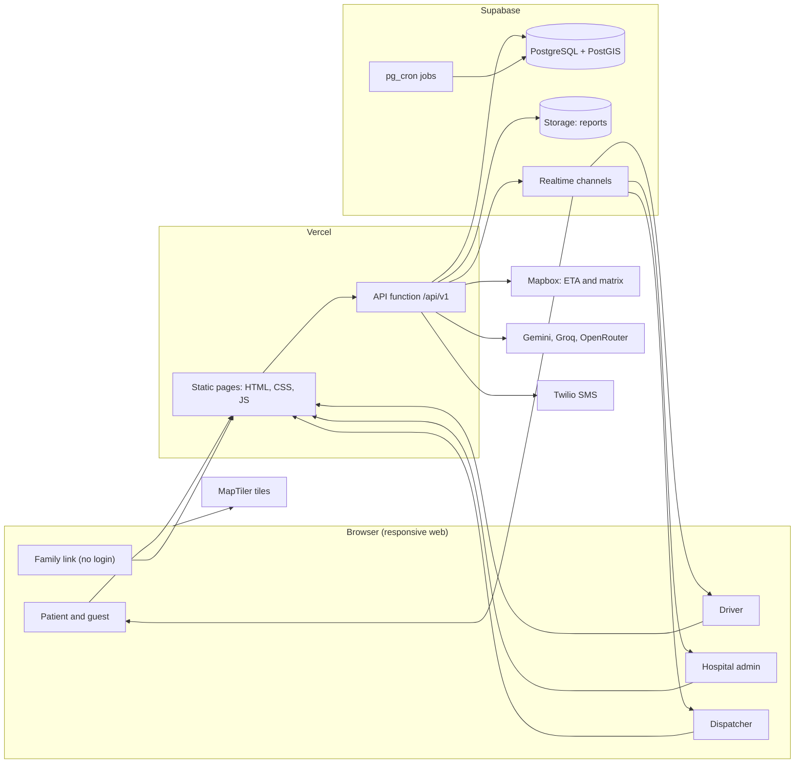
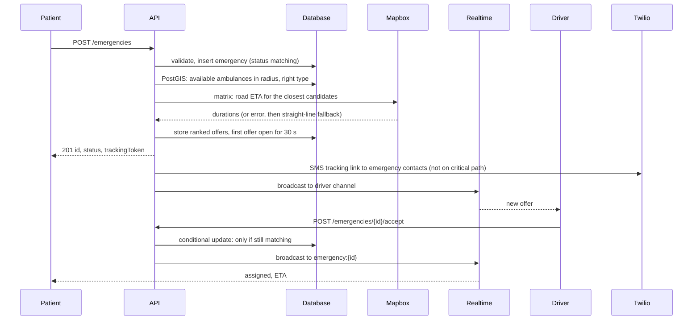

# Architecture

This document describes how CareRoute is put together. Decisions behind it are in `00-decisions.md`. Items marked PROPOSED are not approved.

## 1. The shape of the system

One repository deployed on Vercel serves the static web UI (HTML, CSS and JavaScript in `public/`) and the REST API (one Node.js function that routes `/api/v1/*`). Supabase holds the data, the files, the realtime channels and the scheduled jobs. Four outside services are reached from the server only: Mapbox, a language model (Gemini, Groq or OpenRouter), Twilio, and, from the browser, MapTiler tiles.

The browser never talks to the database. It talks to the API, to Realtime for live updates, and to MapTiler for tiles.

## 2. Why the API owns every database write

- Authorization lives in one place, the API, where ownership and role checks are tested.
- Row Level Security is turned on for every table with no policy for the `anon` and `authenticated` database roles. If the public key ever misbehaves, it can read nothing. This is a backstop, not the main control.
- The service role key and the database connection string exist only in server environment variables.

## 3. The Care Thread

Every case is one thread that connects four things: the patient, the ambulance, the hospital and the reports. This is the idea behind both the data and the interface.

| Node | Data behind it | Visible to |
| --- | --- | --- |
| Patient | `emergencies`, medical ID, contacts | Patient, assigned driver (limited), dispatcher |
| Ambulance | `ambulances`, latest location, offers | Patient, family (position and ETA only), hospital, dispatcher |
| Hospital | `hospitals`, beds, pre-alert | Driver, dispatcher, the hospital itself |
| Reports | `medical_reports`, shares | Patient, and only those the patient shared with |

The interface shows this thread as one repeated component (see `11-design-system.md` section 8). The data model keeps an event row for every step, so the thread can be rebuilt for any case.

## 4. Main flow: raising an SOS

Notes:

- The conditional update is how "first driver to accept wins" is enforced. A second accept finds the row no longer `matching` and returns 409.
- If the offer is not accepted within 30 seconds, a pg_cron job calls a database function that expires it and opens the next offer. The function and its schedule are described in `06-emergency-lifecycle.md`.
- The SMS and the realtime broadcast happen after the response is ready. A failure in either does not fail the request.

## 5. Live tracking

| Audience | Transport | Status |
| --- | --- | --- |
| Patient, driver, hospital admin, dispatcher | Supabase Realtime private channel `emergency:<id>` | LOCKED transport, PROPOSED authorization (Q-14) |
| Family link without login | Polling `GET /emergencies/{id}/track?token=...` | PROPOSED (P-10) |

Driver pings arrive by `POST /ambulances/{id}/location`. The API stores the latest position and, when the ambulance is on a trip, broadcasts it to the emergency channel. Position history is kept only as long as the retention decision allows (Q-10).

The map marker moves smoothly between pings. This is interpolation of position, not decoration.

## 6. Matching, in outline

The exact weights are OPEN (Q-08). The steps are fixed by the collection:

1. Filter ambulances that are `available`, of the requested type, within a radius, using PostGIS.
2. Ask Mapbox for road ETA from each candidate to the patient.
3. Rank by ETA and type.
4. Offer to the best first. Each offer lasts 30 seconds. Move to the next on expiry or decline.
5. First accept wins.

Hospital recommendation for a case ranks by road ETA, presence of an emergency department, matching specialty and free ICU beds. Each recommendation carries a numeric `score` and a text `reason`, so the driver can see why.

## 7. Failure modes and what the user sees

| Failure | User-visible behavior |
| --- | --- |
| Mapbox unavailable | Ranking uses straight-line distance. ETA is labelled as an estimate. |
| No ambulance accepts | Request moves to a failed-match state (name OPEN, Q-06) and the dispatcher sees it. The patient is told plainly and shown the emergency number. |
| Realtime disconnects | Client reconnects and falls back to polling until it does. |
| SMS fails | Patient sees the tracking link and a share action. The case continues. |
| Database unavailable | Health check fails. Pages show a clear error with the emergency number. |
| Model providers all fail | Triage returns the rule-layer result only, with the standard disclaimer. |

## 8. Where each concern lives

| Concern | Location |
| --- | --- |
| Request validation | Zod schemas in `server/routes`, applied before any other work |
| Authorization | `server/auth` |
| Matching and ranking | `server/matching` |
| Triage rules and model chain | `server/triage` |
| Third-party adapters | `server/adapters` |
| State machine | `server/emergency` plus database constraints |
| Design tokens, components and pages | `public/css`, `public/js/components`, `public/js/pages` |
| Migrations | `supabase/migrations` |
