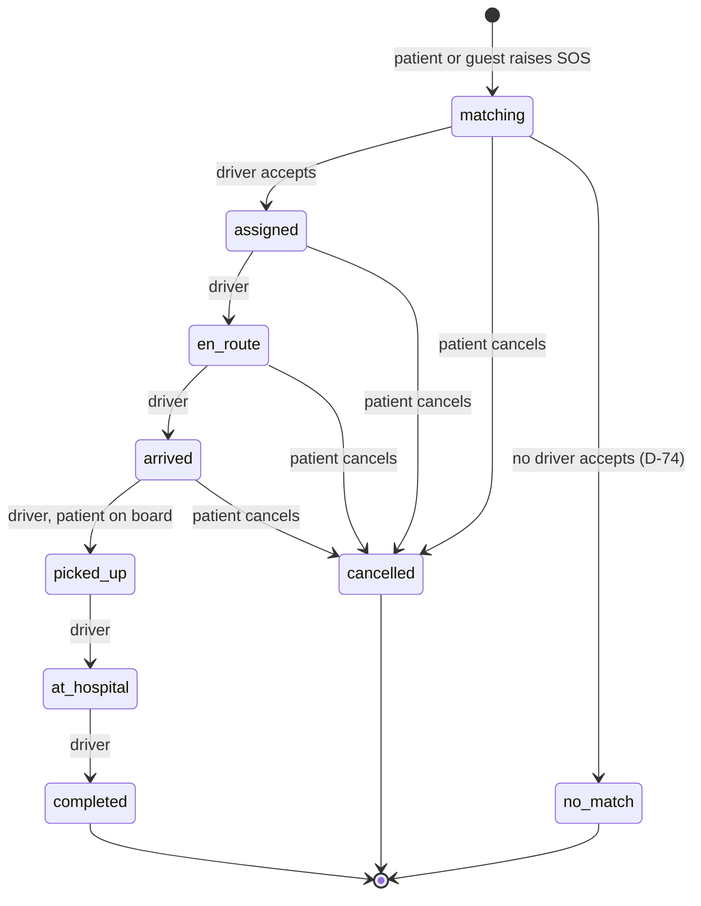

# Emergency lifecycle

> **Scope (D-72):** this is a synthetic demo. Seeded demo crews answer requests (D-78) and nothing real is dispatched. Decisions D-72 to D-79 answer the former open questions Q-03, Q-05 to Q-09, Q-12, Q-14 and Q-21. Where this page still says OPEN or PROPOSED about those, the decisions win.

The states and moves below come from the Postman collection. Anything marked OPEN or PROPOSED is not decided. Since 2026-10-24 the trip has no destination hospital step and no hospital pre-alert (D-30).

## 1. States

| State | Meaning | Source |
| --- | --- | --- |
| `matching` | SOS created, an ambulance is being found | COLLECTION |
| `assigned` | A driver accepted | COLLECTION |
| `en_route` | Ambulance is heading to the patient | COLLECTION |
| `arrived` | Ambulance is at the patient | COLLECTION |
| `picked_up` | Patient is on board | COLLECTION |
| `at_hospital` | Ambulance reached the hospital | COLLECTION |
| `completed` | Trip finished | COLLECTION |
| `cancelled` | Patient cancelled before pickup | COLLECTION |
| `no_match` | Nobody accepted within 5 offers (D-74) | D-74 |

The hospital the ambulance goes to is not recorded. The driver decides it outside CareRoute (D-30).

The collection says a new SOS starts as `matching` or `assigned`. `assigned` is possible when an offer is accepted immediately.

## 2. Allowed moves

Rules:

1. Moves go forward only. No skipping, no going back. A request that tries one returns 409. This rule is PROPOSED where the collection is silent, and consistent with the 409 test for an already finished trip.
2. Only the driver who accepted may change the trip state. Others get 403.
3. `picked_up` takes only `status`. There is no destination and no pre-alert (D-30).
4. Cancel is allowed only before `picked_up`. COLLECTION ("Patients may cancel before pickup").
5. Feedback is allowed only in `completed`. COLLECTION.
6. A terminal state (`completed`, `cancelled`, failed) never changes again.
7. Every move writes one `emergency_events` row in the same transaction as the state change.

## 3. Offers and the 30 second expiry

1. Matching ranks candidate ambulances and stores them as ordered offers.
2. Only the first offer is `open`. It has `expires_at` set 30 seconds after it opened. COLLECTION.
3. The driver sees it in the inbox. Accepting calls `accept_emergency`, a conditional update that works only while the emergency is `matching` and the offer is open.
4. If the driver does not accept in time, `expire_offers()` marks it `expired` and opens the next. If the driver rejects (D-32), the offer becomes `declined` and the next opens without waiting. The reject endpoint is PROPOSED (P-20).
5. `expire_offers()` runs from pg_cron. The schedule must be shorter than a minute. The exact pg_cron syntax and the minimum interval must be confirmed against the installed version (see `02-trd.md` section 9).
6. When offers run out (at most 5, D-74), the emergency moves to `no_match`, the patient is shown the emergency number, and the admin view lists it (P-18). There is no automatic retry; the patient may send a new request.

## 4. Ambulance eligibility

An ambulance is a candidate only if all are true:

- `status` is `available`. COLLECTION.
- Its type satisfies the request. Whether an ICU unit may serve a BLS request is OPEN.
- It is within the search radius.
- Its last ping is recent. The limit is OPEN.

When an ambulance accepts, its status becomes `busy`. When the trip ends, it returns to `available` only if the driver says so (PROPOSED, so a driver is not offered work immediately after a trip).

## 5. Tracking

- The patient gets `trackingToken` once, in the creation response.
- The family link contains the token. The server stores only a hash.
- The public track response contains status, ambulance position and ETA only. No names, no medical data, no phone numbers.
- Token lifetime (D-75): active emergency plus 2 hours after it ends, never more than 24 hours after creation.

## 6. What the crew sees

The assigned driver sees the pickup location, `emergencyType`, `conscious`, `patientCount` and `notes`. Medical ID details are included only if `shareWithCrew` is true. Reports are included only if Q-11 allows crew access. Hospital pre-alerts were removed (D-30).

## 7. SMS to contacts

On SOS creation, each saved contact gets one SMS with the tracking link. COLLECTION. The message names no health detail. A failed send is recorded and does not stop the emergency.
