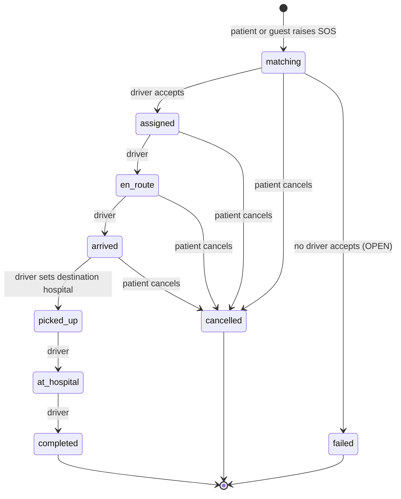

# Emergency lifecycle

The states and moves below come from the Postman collection. Anything marked OPEN or PROPOSED is not decided.

## 1. States

| State | Meaning | Source |
| --- | --- | --- |
| `matching` | SOS created, an ambulance is being found | COLLECTION |
| `assigned` | A driver accepted | COLLECTION |
| `en_route` | Ambulance is heading to the patient | COLLECTION |
| `arrived` | Ambulance is at the patient | COLLECTION |
| `picked_up` | Patient is on board, destination hospital chosen | COLLECTION |
| `at_hospital` | Ambulance reached the hospital | COLLECTION |
| `completed` | Trip finished | COLLECTION |
| `cancelled` | Patient cancelled before pickup | COLLECTION |
| failed match | Nobody accepted. Name and rules OPEN (Q-06, Q-07) | OPEN |

The collection says a new SOS starts as `matching` or `assigned`. `assigned` is possible when an offer is accepted immediately.

## 2. Allowed moves

Rules:

1. Moves go forward only. No skipping, no going back. A request that tries one returns 409. This rule is PROPOSED where the collection is silent, and consistent with the 409 test for an already finished trip.
2. Only the driver who accepted may change the trip state. Others get 403.
3. `picked_up` requires `destinationHospitalId`. Setting it sends the pre-alert to that hospital.
4. Cancel is allowed only before `picked_up`. COLLECTION ("Patients may cancel before pickup").
5. Feedback is allowed only in `completed`. COLLECTION.
6. A terminal state (`completed`, `cancelled`, failed) never changes again.
7. Every move writes one `emergency_events` row in the same transaction as the state change.

## 3. Offers and the 30 second expiry

1. Matching ranks candidate ambulances and stores them as ordered offers.
2. Only the first offer is `open`. It has `expires_at` set 30 seconds after it opened. COLLECTION.
3. The driver sees it in the inbox. Accepting calls `accept_emergency`, a conditional update that works only while the emergency is `matching` and the offer is open.
4. If the driver does not accept in time, `expire_offers()` marks it `expired` and opens the next. If the driver declines, the same happens without waiting. A decline endpoint is not in the collection, so it is PROPOSED.
5. `expire_offers()` runs from pg_cron. The schedule must be shorter than a minute. The exact pg_cron syntax and the minimum interval must be confirmed against the installed version (see `02-trd.md` section 9).
6. When offers run out, the emergency moves to the failed-match state and the dispatcher is notified. How many rounds, and any retry, are OPEN (Q-07).

## 4. Ambulance eligibility

An ambulance is a candidate only if all are true:

- `status` is `available`. COLLECTION.
- Its type satisfies the request. Whether an ICU unit may serve a BLS request is OPEN.
- It is within the search radius.
- Its last ping is recent. The limit is OPEN.

When an ambulance accepts, its status becomes `busy`. When the trip ends, it returns to `available` only if the driver says so (PROPOSED, so a driver is not offered work immediately after a trip).

## 5. Tracking

- The patient gets `trackingToken` once, in the creation response.
- The family link contains the token. The server stores only a hash.
- The public track response contains status, ambulance position and ETA only. No names, no medical data, no phone numbers.
- Token lifetime is OPEN (Q-09). Until decided, it must not outlive the emergency's terminal state by default (PROPOSED).

## 6. Pre-alert

When the state becomes `picked_up` with a destination, the hospital's incoming list includes the case with: `emergencyId`, case type, patient condition, ETA. The "patient condition" content is derived from fields the patient or crew entered: `emergencyType`, `conscious`, `patientCount`, `notes`. Medical ID details are included only if `shareWithCrew` is true. Reports are included only as described in `08-medical-reports.md`.

## 7. SMS to contacts

On SOS creation, each saved contact gets one SMS with the tracking link. COLLECTION. The message names no health detail. A failed send is recorded and does not stop the emergency.
