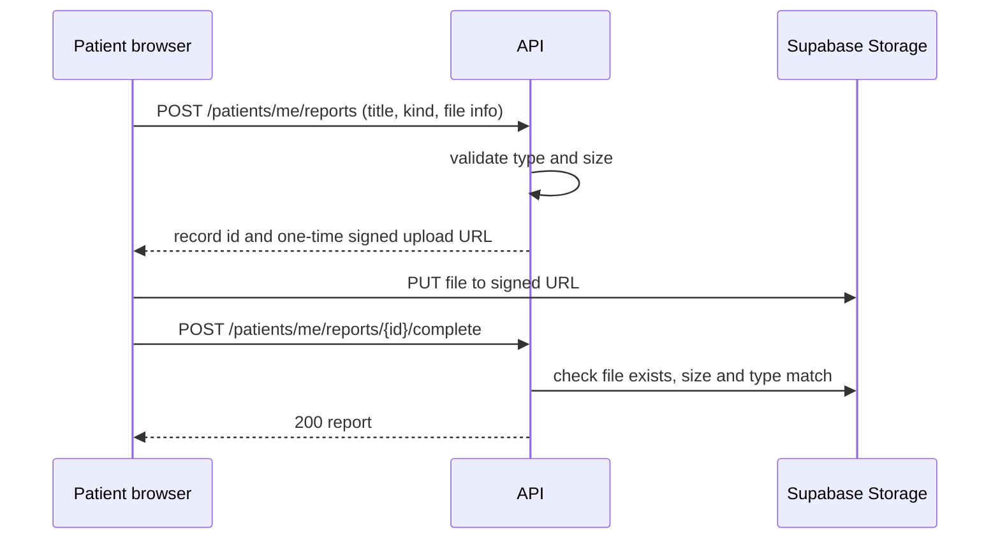

# Medical reports

Status: new feature (D-06). Everything below is PROPOSED except the decision that the feature exists. Open questions are marked.

## 1. What it is

A patient keeps their own medical files in CareRoute: lab reports, prescriptions and scans. During an emergency, the patient's sharing choices decide whether the crew and the receiving hospital can see them.

## 2. Principles

1. Private by default. A new report is visible to its owner only.
2. Sharing is an explicit choice, per report, and can be withdrawn.
3. Access is by short-lived signed links. Files are never public.
4. Every access by anyone other than the owner is recorded and can be shown to the owner.
5. Delete means delete: the record and the file.

## 3. Report fields

| Field | Notes |
| --- | --- |
| `id`, `ownerUserId` | |
| `title` | Text typed by the patient |
| `kind` | `lab`, `prescription`, `scan`, `other`. List is PROPOSED. |
| `fileName`, `contentType`, `sizeBytes` | Validated on the server |
| `storagePath` | Server only, never returned |
| `uploadedAt` | |
| `shareWithCrew` | boolean, default false |
| `sharedHospitalIds` | list, default empty |

## 4. Upload flow

The browser never gets a permanent storage key. The upload URL expires quickly and works for one path.

## 5. Limits (OPEN, Q-11)

Allowed file types, maximum size, number of files per patient and the Supabase free storage quota are not decided. The free quota is a hard ceiling for the demo and must be stated in `16-deployment-and-environments.md` once confirmed. A common starting point is PDF, JPEG and PNG, but that is a suggestion, not a decision.

Server checks regardless of the final list:

- Check the content type against the allowed list, and check the file's actual first bytes, not only the name or declared type.
- Reject over-size files before and after upload.
- Never execute, render server side, or transform an uploaded file.
- Serve downloads with `Content-Disposition` and a fixed safe content type so a file cannot run as a page.
- Malware scanning is not available on the free stack. The docs and UI must not claim files are scanned.

## 6. Who sees what

| Viewer | Can see | Condition |
| --- | --- | --- |
| Owner | All own reports | Always |
| Driver and crew | Reports with `shareWithCrew` true | Only for an emergency where this driver is assigned, and only while that emergency is active |
| Hospital admin | Reports whose `sharedHospitalIds` includes their hospital | Only for an emergency routed to that hospital, and only after `picked_up` |
| Dispatcher | Nothing | Dispatch does not need report contents |
| Family link | Nothing | Never |

What the crew needs during a short trip and whether crew should see full files or only a summary is OPEN (Q-11).

## 7. Audit

Every non-owner view writes an `emergency_events` row of type `report_accessed` with the viewer, report id and time. The owner can see this list. The files themselves are not copied into the event.

## 8. Deletion

- Owner deletes a report: remove the storage object first, then the row. If the object removal fails, keep the row marked `pending_delete` and retry. The user is told the truth about the state.
- Account deletion removes all reports. The process and any legal hold are OPEN (Q-10).

## 9. Interface

- Upload is a plain file picker with progress and a clear failure message.
- The sharing screen states in one sentence who will be able to see the file, before the user confirms.
- No preview of file contents is generated on our servers.
- The patient sees a "Who viewed my reports" list.

## 10. Tests required

- A patient cannot read or delete another patient's report (IDOR test).
- A hospital cannot read a report that was not shared with it, or for a case not routed to it.
- An expired signed link stops working.
- A disallowed file type and an over-size file are rejected.
- Withdrawing sharing stops access immediately.
- Access events are written.
